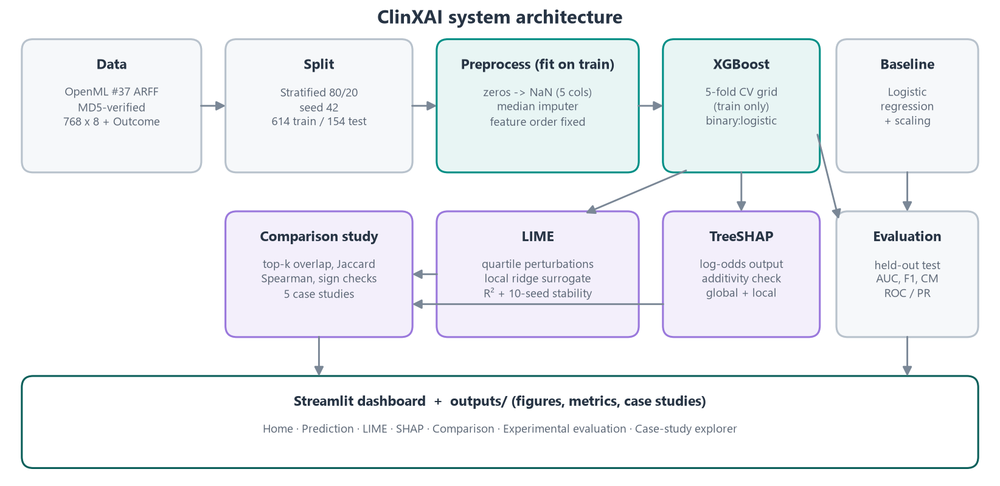
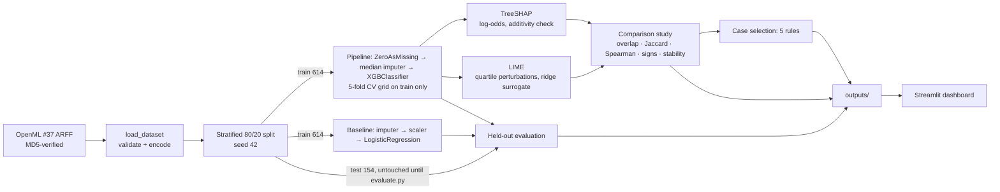

# ClinXAI technical documentation

## 1. Architecture

## 2. Module map

| Module | Responsibility |
|---|---|
| `src/config.py` | Paths, seeds, feature order, feature definitions, thresholds, palette. Every other module imports from here. |
| `src/data.py` | Downloading the data with MD5 verification, writing provenance, the ARFF parser, schema and label validation, the stratified split, and reading/writing the split CSVs. |
| `src/preprocessing.py` | The `ZeroAsMissing` transformer, the median-imputer pipeline (outputs pandas with named columns), the preprocessing summary, and `validate_patient_input` for the what-if editor. |
| `src/model.py` | The XGBoost and baseline pipelines, the CV grid search, CV summaries, prediction helpers (probability and raw margin), persistence and metadata. |
| `src/metrics.py` | Held-out metrics, ROC/PR points, bootstrap AUC confidence interval and the paired AUC difference. |
| `src/shap_explainer.py` | The TreeExplainer wrapper, `Explanation` objects that mark imputed values, additivity verification and global importance. |
| `src/lime_explainer.py` | The LimeTabularExplainer builder, a prediction function that records the perturbation batch, `LimeResult` (weights, rules, R², local prediction, neighbourhood) and multi-seed stability. |
| `src/comparison.py` | Top-k overlap, Jaccard, Spearman rank correlation, sign agreement and the tolerance-filtered direction disagreement. |
| `src/experiment.py` | The study over every test patient, confidence bands, Spearman relationship analysis with Bonferroni correction, and band summaries. |
| `src/case_studies.py` | The five selection rules, reporting a case as unavailable when no patient qualifies, and the evidence statements for each case. |
| `src/plotting.py` | All matplotlib figures, including the native SHAP waterfall, beeswarm and force plots. |
| `src/ui.py` | CSS and small HTML components for the dashboard. |
| `train_model.py` | Data acquisition, splitting, tuning, training and saving. **Does not touch the test labels.** |
| `evaluate.py` | Held-out metrics, SHAP global outputs, the consistency study, case studies and generated findings. |
| `app.py` | The Streamlit dashboard (7 pages). |

## 3. Key design decisions

### 3.1 Preprocessing and leakage control
- Zeros in Glucose, BloodPressure, SkinThickness, Insulin and BMI are converted to NaN. A zero in Pregnancies is kept.
- The `SimpleImputer(strategy="median")` sits **inside** the sklearn pipeline. During the grid search it is refitted on each training fold. In the final model it is fitted on the 614 training rows only. `tests/test_preprocessing.py` checks that the medians match the training data and differ from medians computed on the test data.
- The test split is first used in `evaluate.py`. Hyper-parameters were chosen by 5-fold CV AUC on the training split, using a small grid declared in advance in `config.XGB_PARAM_GRID`. The decision threshold is fixed at 0.5 and is never tuned.

### 3.2 Why XGBoost
Gradient-boosted trees model non-linear thresholds (for example, risk rising sharply above a glucose level) and interactions without manual feature engineering. They are insensitive to feature scaling, and they support exact, polynomial-time TreeSHAP. On this small dataset XGBoost does **not** beat logistic regression by a statistically meaningful margin (section 5 of the experiment report). It was chosen for its explanation properties and because it is the assigned model, not because it scored higher.

### 3.3 Explanation output spaces
| | TreeSHAP | LIME |
|---|---|---|
| Target explained | XGBoost raw margin (log-odds of class 1) | `predict_proba[:, 1]`, i.e. P(diabetes-positive) |
| Units of attributions | log-odds | coefficients of a ridge surrogate on binary "same quartile bin" indicators, in probability units |
| Additivity | exact: base + Σφ = margin (verified to < 2e-6) | approximate: intercept + Σw·z ≈ surrogate prediction |
| Baseline | E[f(X)] under tree-path-dependent expectations | other quartile bins of the training distribution |
| Randomness | deterministic | depends on the sampling seed |

The conversion is P = sigmoid(base + Σφ). SHAP values are never added to a probability. `verify_additivity` reports how badly the naive "probability + SHAP" sum fails (error up to about 3.6 probability units), which shows why the unit distinction matters.

### 3.4 Same input for both explainers
LIME's reference data is the **preprocessed** training split, and the explained instance is the **preprocessed** patient vector. TreeSHAP explains exactly the same vector (`tests/test_explainers.py::test_lime_and_shap_explain_the_same_input`). LIME's perturbations go through the full fitted pipeline. The imputer leaves them unchanged, because the preprocessed space contains no zeros in the five imputed columns.

### 3.5 Recording LIME's neighbourhood
LIME does not return its perturbations. `RecordingPredictFn` wraps the pipeline's `predict_proba` and keeps the last batch it was given. This captures the real neighbourhood (the first row is the patient) through the public API only, and the dashboard plots it.

### 3.6 Imputed values in explanations
The SHAP display data labels imputed features as `125 (imputed)`. The case-study text also says when an attribution belongs to an imputed training median rather than a measurement.

## 4. Reproducibility
- Seeds: split, CV folds, XGBoost and the baseline all use 42. The primary LIME explanation uses seed 42. Stability is measured over seeds 0–9.
- `LimeTabularExplainer` keeps one random generator that advances with every explanation. In the study, one explainer per seed is used for all 154 patients in test-set order, so a patient's study draw depends on that order. `run_study` hands its per-patient LIME and stability results to `evaluate.py`, so the case-study tables and figures reuse **exactly** the study's draws. The dashboard creates a fresh explainer for every explanation, so its result for a given patient and seed does not depend on browsing order. That live draw is still a different random draw from the study's, and differences are of the size measured by the seed-stability analysis.
- The SHAP beeswarm jitters its dots with NumPy's global generator, which is seeded before plotting.
- Concurrency: Streamlit serves each visitor in its own thread, and SHAP's plots draw on pyplot's process-global current figure. `plotting.exclusive_figure` holds one process-wide lock while a figure is built and rendered, and closes any figure left open by an interrupted run.
- `models/model_metadata.json` records the library versions, best parameters, CV scores, data MD5 and feature order.
- `load_pipeline` refuses to load a model whose feature order differs from `config.FEATURES`.
- Re-running `train_model.py` and then `evaluate.py` gives the same numbers on the same library versions.

## 5. Testing
`pytest` runs 92 tests in `tests/`:

| File | Covers |
|---|---|
| `test_data.py` | MD5, columns and order, row and class counts, label encoding, malformed or missing files, disjoint and stratified reproducible split, ids traceable to the source |
| `test_preprocessing.py` | zero→NaN only in the five columns, training-only medians, no NaN after transform, idempotence, rejection of reordered columns, 10 invalid-input cases |
| `test_model.py` | probability range and row sums, class order, sigmoid(margin) = probability, save/load round trip, booster feature names, column realignment, metric sanity |
| `test_explainers.py` | LIME generation and determinism, the prediction function equals the pipeline, the recorded neighbourhood, stability metrics, invalid LIME inputs, SHAP shapes, **additivity in log-odds**, the naive probability sum failing, imputed-value marking, identical explainer input |
| `test_comparison_and_cases.py` | metric values on hand-computed vectors, tolerance logic, case-rule selection, *unavailable* reporting, the instability fallback, the relationship analysis, and that `run_study` hands over the exact LIME draws behind its table |
| `test_plotting_and_app.py` | 12 chart builders plus the native SHAP plots save non-trivial PNGs; Streamlit `AppTest` renders all 7 pages without exceptions, plus disclaimer text, patient switching and case navigation; SHAP figures rendered from concurrent threads are byte-identical to one-at-a-time renders |

The dashboard tests need the saved artefacts. They **fail** rather than skip when the artefacts are missing, so a passing run always means the app was really rendered.
